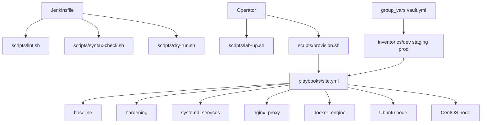

# ConfigFleet

ConfigFleet is a set of Ansible playbooks that provision and harden Ubuntu and CentOS hosts the same way every time. One playbook creates operator accounts, locks down SSH, writes sysctl and login policy, installs a systemd timer, publishes an Nginx reverse proxy, and installs Docker Engine.

Secrets stay in Ansible Vault. Everything that changes between dev, staging, and prod lives in that environment's group vars. Bash scripts cover the chores around the playbooks: preparing a fresh host, bringing up a local lab, and running the same checks Jenkins runs.

## Features

- Idempotent roles for users and SSH keys, baseline hardening, systemd units, an Nginx reverse proxy, and Docker Engine. Ubuntu and CentOS (Red Hat family) tasks are separate where the package manager, service name, or firewall tool differs.
- Ansible Vault for the API token, registry password, and account password hashes. Each environment has its own vault file. Group vars only refer to the vault variable names.
- Per-environment group vars for SSH attempt limits, the login banner, Nginx upstreams, Docker log limits, and who is in the `docker` group. Production adds a break-glass account that dev and staging do not have.
- `scripts/node-bootstrap.sh` prepares a fresh host before the first Ansible run: Python 3, sudo, the login user, an authorized key, and a sudoers drop-in. It is safe to run twice.
- A Jenkins pipeline that runs `ansible-lint`, `ansible-playbook --syntax-check`, and `ansible-playbook --check --diff`. The job fails if any of those fail. The same scripts run on a laptop.

## Architecture



`playbooks/site.yml` is the only entry point. It applies five roles, in order, to every host in the inventory:

1. **baseline** creates the `configfleet` group, a sudoers drop-in, the operator accounts, and their authorized keys.
2. **hardening** installs an sshd config (checked with `sshd -t` before it is written), a sysctl drop-in, password aging in `login.defs`, and tighter modes on the account files. It removes a short list of packages and disables a few services only when they are actually installed. When `hardening_manage_firewall` is true it opens SSH, HTTP, and HTTPS with ufw on Debian and firewalld on Red Hat, then sets the default incoming policy to deny.
3. **systemd_services** installs a small Bash heartbeat, an environment file that is mode `0600`, and a oneshot service plus a timer. The script records a fingerprint of the API token and never writes the token itself.
4. **nginx_proxy** installs Nginx as a reverse proxy. `/healthz` returns `ok`. `/app/` is proxied at the upstream list from group vars.
5. **docker_engine** installs Docker Engine from Docker's own apt or yum repository, writes `/etc/docker/daemon.json`, adds the operator accounts to the `docker` group, and renders `/root/.docker/config.json` from the vault registry password.

AllowUsers in sshd is derived from the managed user list plus the Ansible login user, so adding an account in group vars does not lock that person out.

## Layout

```
ansible.cfg
requirements.yml          Ansible collections
requirements-dev.txt      ansible-core and ansible-lint for local runs
Jenkinsfile
inventories/
  dev|staging|prod/
    hosts.yml
    group_vars/all/main.yml
    group_vars/all/vault.yml
playbooks/site.yml
roles/
  baseline/
  hardening/
  systemd_services/
  nginx_proxy/
  docker_engine/
scripts/                  bootstrap, lab, lint, syntax-check, provision, vault
docker/                   Ubuntu 22.04 and CentOS Stream 9 lab images
tests/run.sh              full local test
tests/verify.yml          checks a node after provisioning
```

## Running the lab

The lab is two privileged systemd containers, one Ubuntu 22.04 and one CentOS Stream 9, reachable over SSH on ports 2222 and 2223. Docker is required on the machine that runs the lab. The Jenkins pipeline itself does not start the lab; it only lints, syntax-checks, and dry-runs whatever inventory you point it at.

```bash
python3 -m venv .venv
. .venv/bin/activate
pip install -r requirements-dev.txt
ansible-galaxy collection install -r requirements.yml -p collections
cp .env.example .env
./scripts/lab-up.sh
./scripts/provision.sh --inventory inventories/dev
```

`scripts/lab-up.sh` writes `.vault_pass` from `.env` if you do not already have one, generates a lab SSH key under `.lab/`, and starts the containers. `.vault_pass`, `.env`, and `.lab/` are gitignored.

The vault files committed in this repo are encrypted with the lab password in `.env.example`. They hold sample tokens and password hashes so the playbooks can be decrypted and applied locally. Production should use a different vault password, stored in Jenkins as the secret file credential `configfleet-vault-password`. Do not reuse the lab password there.

Useful commands:

```bash
./scripts/vault.sh view inventories/dev/group_vars/all/vault.yml
./scripts/dry-run.sh --inventory inventories/dev
./scripts/syntax-check.sh
./scripts/lab-down.sh
```

`scripts/node-bootstrap.sh` is what the lab entrypoint runs, and it is the script to use on a real fresh host:

```bash
sudo ./scripts/node-bootstrap.sh --user ansible --pubkey-file /root/ansible.pub
```

Staging and prod inventories ship with private example addresses (`10.20.0.0/16` and `10.30.0.0/16`). Point those hosts at your own machines before a real apply. A dry run needs the hosts to answer SSH; syntax-check does not.

## Testing

```bash
./tests/run.sh
```

That script installs the dev tools if needed, runs shellcheck, checks the heartbeat script, runs ansible-lint and syntax-check for all three inventories, decrypts the sample vaults, boots the lab, checks that bootstrap is idempotent, applies the playbook twice, runs a `--check --diff` dry run, and applies `tests/verify.yml`. The second apply and the dry run are expected to report no changes. Set `KEEP_LAB=1` to leave the containers up when the script exits.

`make test` runs the same script. `make lint`, `make syntax`, `make lab-up`, and `make provision` are the individual steps.

## Design decisions

- Role defaults hold OS-family behavior. Inventory group vars hold environment behavior. A variable in group vars replaces the role default, so environment files set complete values rather than trying to merge with the default.
- Vault files are encrypted per environment. `main.yml` next to them is readable and only points at `vault_*` names, so a review can see where a secret is used without decrypting it.
- sshd is a full template, not a collection of `lineinfile` edits, and the template is validated with `sshd -t` before it replaces the live file. A task also restarts sshd if the running daemon does not match that file, which covers a play that died after writing the file but before the handler ran.
- The heartbeat timer is the thing that keeps updating state. The playbook records one heartbeat so the file exists before the first timer tick, and skips that command once the file is there.
- Registry credentials are written to Docker's `config.json` with mode `0600`. The playbook does not call `docker login`, so a bad password does not fail provisioning and the secret is not in a shell history.
- The dev inventory sets `hardening_manage_firewall: false`. ufw and firewalld are real tasks and staging and prod turn them on, but the local lab runs in containers that do not provide the netfilter matches those tools load. Enabling them in the lab drops SSH to the container. On a normal VM the same tasks install ufw or firewalld, allow ports 22, 80, and 443, and deny other incoming traffic.
- EL9 ships `curl-minimal`, which conflicts with the full `curl` package, so the Red Hat package list does not replace it. `deb822_repository` needs `python3-debian` on the node, and the Docker role installs that before adding the apt source.
- Jenkins delegates to the scripts under `scripts/` so a laptop and the pipeline run the same commands. The dry-run stage expects the chosen inventory to be reachable, which is the normal case for a fleet that is already under management.

## Requirements

- Ansible 2.16 or newer (`requirements-dev.txt` pins 2.16.14 for the local venv)
- ansible-lint 24.x
- Collections in `requirements.yml`: `ansible.posix` 1.5.4 and `community.general` 8.3.0
- Docker, for the lab only
- shellcheck, if you run `tests/run.sh`
